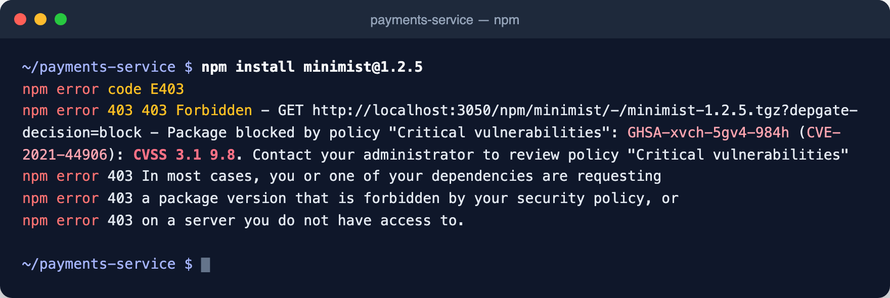
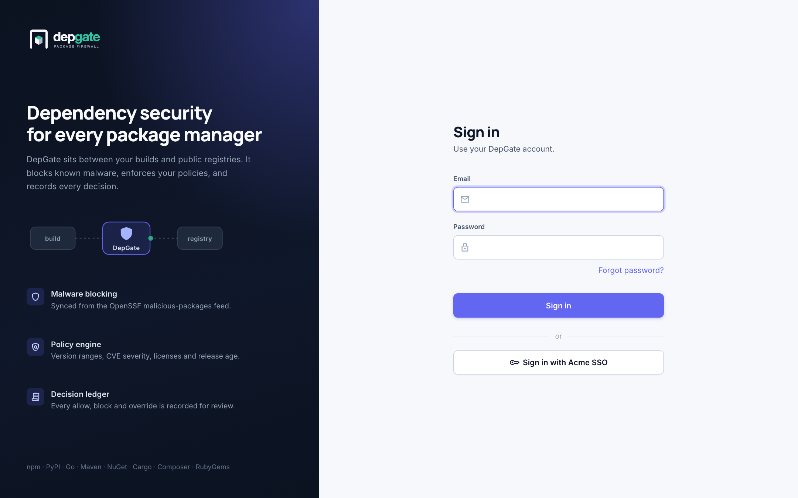
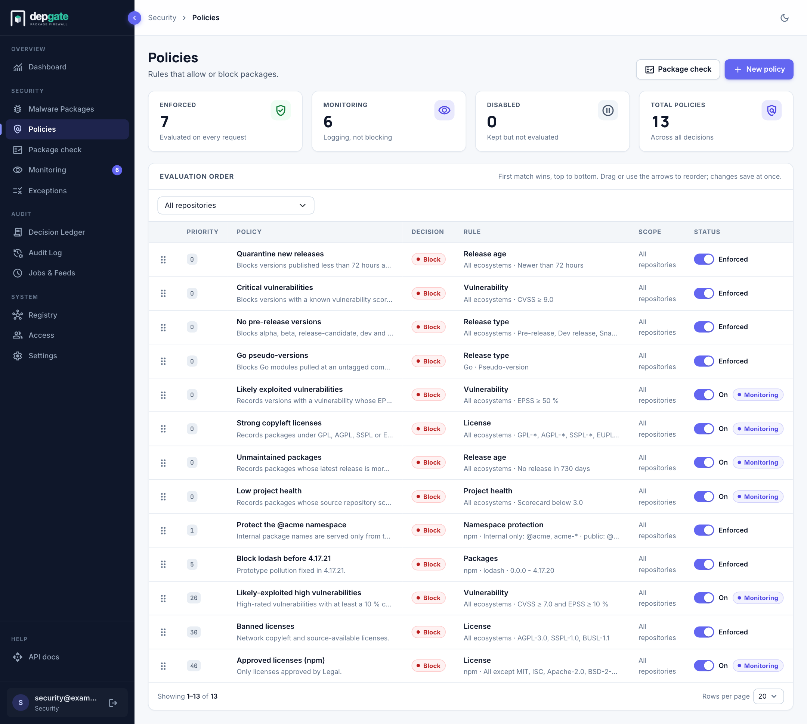
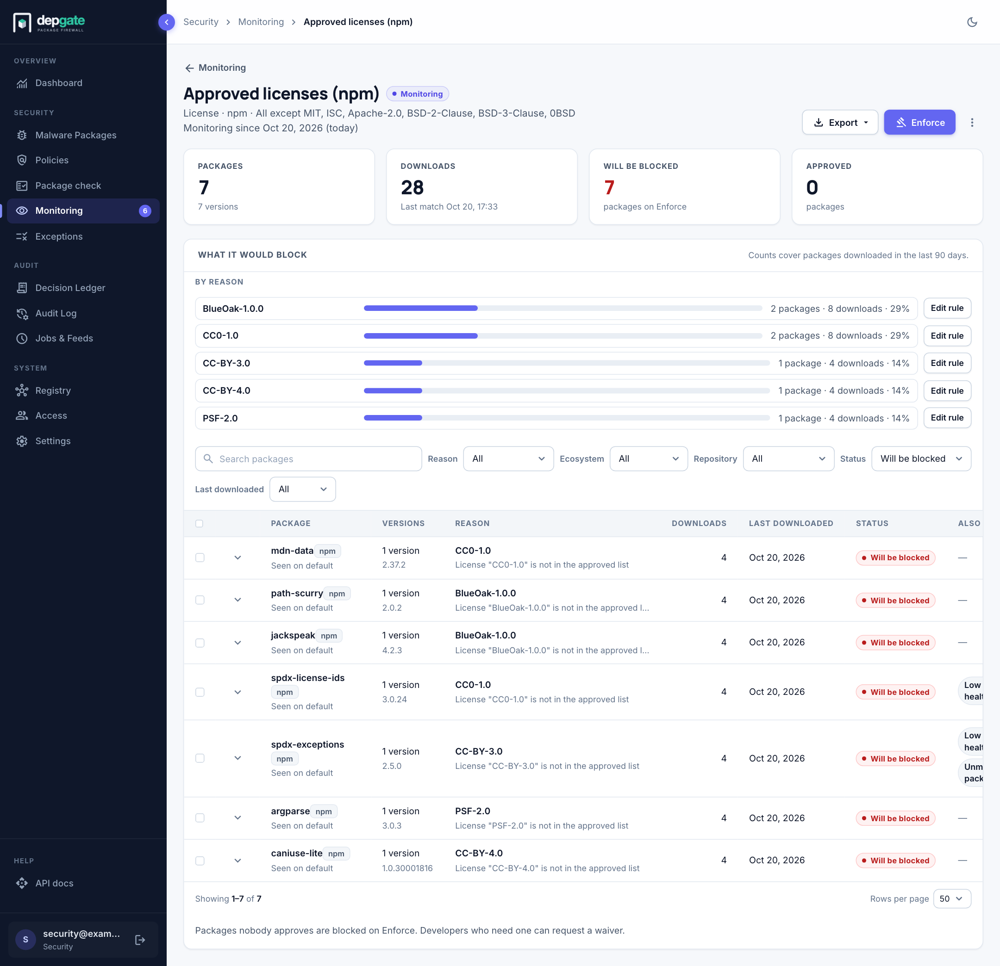
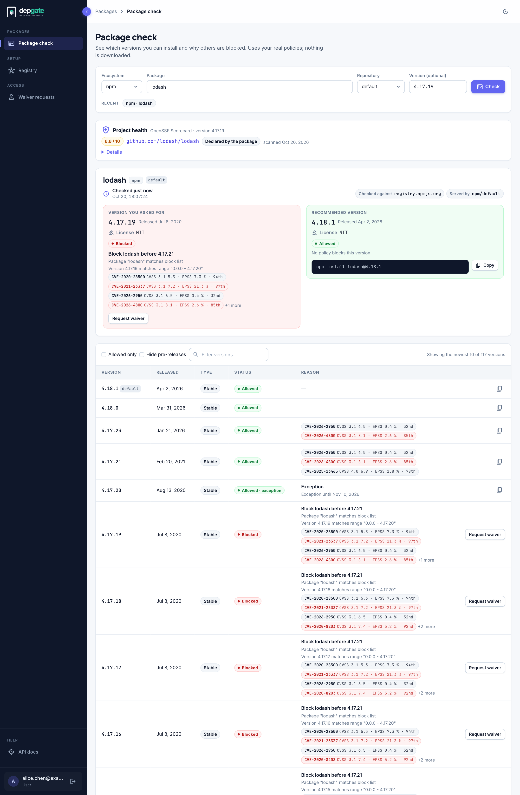
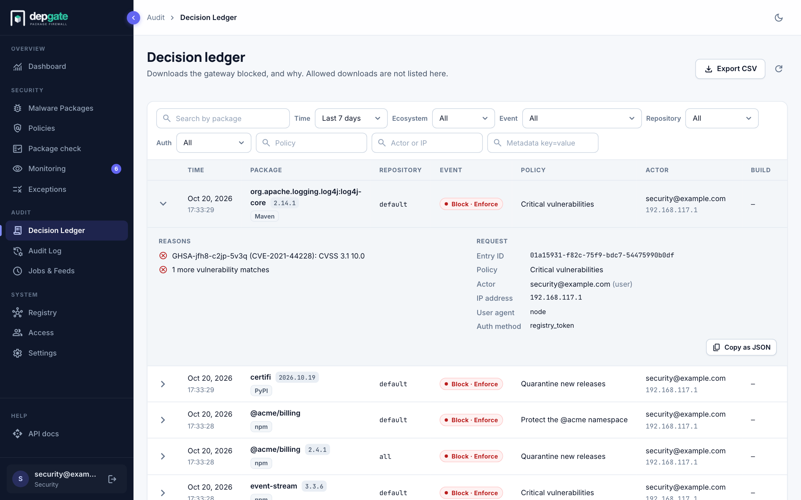
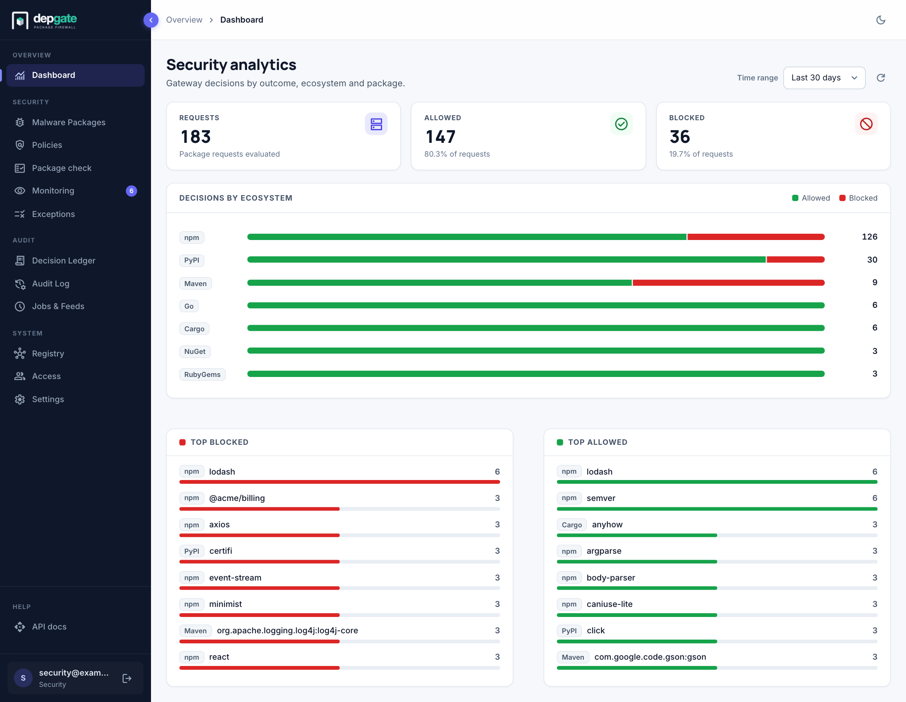
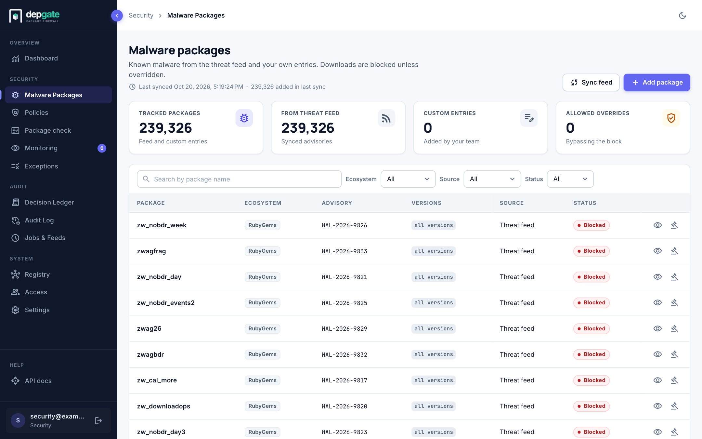

<p align="center">
  <a href="https://github.com/secmods/depgate">
    
  </a>
</p>

<h1 align="center">DepGate</h1>

<p align="center">
  <strong>Control what enters your software supply chain.</strong><br>
  An open-source dependency gateway: one proxy and policy engine in front of npm, PyPI, Maven, Go, NuGet, Cargo, Composer and RubyGems.
</p>

<p align="center">
  <a href="https://github.com/secmods/depgate/actions/workflows/ci.yml"></a>
  <a href="LICENSE"></a>
  <a href="https://github.com/secmods/depgate/stargazers"></a>
  <a href="https://github.com/secmods/depgate/issues"></a>
  <a href="https://github.com/secmods/depgate/pulls"></a>
  <a href="https://github.com/secmods/depgate/commits/main"></a>
  <a href=".nvmrc"></a>
  <a href="CONTRIBUTING.md"></a>
</p>

<p align="center">
  <a href="https://secmods.github.io/depgate/guide/what-is-depgate">Documentation</a> ·
  <a href="https://secmods.github.io/depgate/guide/quick-start">Quick start</a> ·
  <a href="https://secmods.github.io/depgate/developers/connect-package-managers">Connect a package manager</a> ·
  <a href="https://secmods.github.io/depgate/admin/policies">Policies</a> ·
  <a href="https://secmods.github.io/depgate/reference/api">REST API</a> ·
  <a href="https://github.com/secmods/depgate/issues">Issues</a>
</p>

---

## What is DepGate?

DepGate sits between your package managers and the public registries they download from, and decides, version by version, what is allowed into your organization.

Developers and CI pipelines point `npm`, `pip`, `mvn`, `go`, `dotnet`, `cargo`, `composer` or `gem` at DepGate instead of the public registry. DepGate fetches the package from upstream, checks it against the malware list and your policies, and either serves it or refuses it with a clear reason. Nothing reaches a laptop or a build without passing that check, and every decision is recorded.

<p align="center">
  
</p>
<p align="center"><sub>A real install through DepGate. The starter policy <em>Critical vulnerabilities</em> blocks the version, and npm prints the policy and the CVE.</sub></p>

### Why a gateway, not a scanner

Open-source packages are the largest part of most applications and the easiest way in for an attacker. A hijacked maintainer account, a typosquatted name or a package that impersonates an internal one can reach thousands of builds within hours. Scanning after `npm install` is too late: the install scripts have already run.

DepGate moves the decision to the moment of download:

- **Known malware never downloads.** Every request is checked against a continuously synced feed of more than 200,000 malicious packages, before any policy.
- **Risky versions fail with a reason.** A blocked download returns HTTP 403 naming the policy and the finding, with a link to the newest allowed version.
- **One set of rules, everywhere.** A policy covers every developer, every CI runner and every ecosystem you choose, and takes effect within seconds.
- **Every decision on record.** Security and compliance can answer "who installed what, when, and why was it allowed?"

## Demo video

<!--
  Maintainers: GitHub plays .github/assets/demo.mp4 inline only when it is uploaded through the GitHub
  web editor. Edit this README on github.com, drag demo.mp4 into the edit box, and paste the
  https://github.com/user-attachments/assets/<id> URL it produces on a line of its own, right above the
  GIF below (keep the GIF for renderers that cannot play video). Both files come from
  `node docs/scripts/demo-video.mjs` (see docs/scripts/README.md) and can be re-recorded after UI changes.
-->

<p align="center">

  [](https://github.com/user-attachments/assets/43debc5c-6cf1-4654-b9ca-83b3858be98d)
</p>

Two minutes, in five steps: a security engineer creates a policy, a developer's `npm install` is refused with the reason, the decision appears in the Decision Ledger, Package check points at the newest allowed version, and a waiver is requested and approved.

## Features

| | Feature | What it gives you |
|---|---|---|
| 🌐 | **Eight ecosystems, one gateway** | npm, PyPI, Maven, Go modules, NuGet, Cargo, Composer and RubyGems, each on its own URL. Download links are rewritten so clients cannot bypass the gateway. [Connect a package manager →](https://secmods.github.io/depgate/developers/connect-package-managers) |
| 🛡️ | **Malware blocked by default** | A synced feed of known-malicious packages is checked on every download, plus your own entries and overrides. [Malware packages →](https://secmods.github.io/depgate/admin/malware) |
| 📜 | **Policies you can read** | Block by vulnerability (CVSS and EPSS exploit likelihood), license, release age, release type, project health (OpenSSF Scorecard) or package name. Each policy has one rule and states in one sentence what it does. [Policy rules →](https://secmods.github.io/depgate/admin/policy-rules) |
| 👁️ | **Monitor before you enforce** | Run a new policy in monitor mode on real traffic, see exactly which downloads it would break, approve what must keep working, then enforce. [Monitoring →](https://secmods.github.io/depgate/admin/monitoring) |
| 🏷️ | **Dependency-confusion protection** | Your internal package names are served only from your internal registries, never from a public look-alike. [Namespace protection →](https://secmods.github.io/depgate/admin/namespace-protection) |
| 🔎 | **Answers for developers** | Package check shows which versions are allowed, why the others are blocked, and the newest version to install. Blocked developers request a time-bound waiver; Security approves it. [Package check →](https://secmods.github.io/depgate/developers/package-check) · [Waivers →](https://secmods.github.io/depgate/developers/waiver-requests) |
| 🧾 | **Decision Ledger and Audit Log** | Every block is recorded with the reason, the policy and who asked, down to the CI job; every change and sign-in is in the Audit Log. [Decision Ledger →](https://secmods.github.io/depgate/admin/decision-ledger) · [Audit Log →](https://secmods.github.io/depgate/admin/audit-log) |
| 🗂️ | **Repositories** | Proxy public registries and your internal ones (Artifactory, Nexus, GitHub Packages, Verdaccio, …), combine them behind one URL, and scope policies to repositories. [Repositories →](https://secmods.github.io/depgate/admin/repositories) |
| 🔐 | **Enterprise access** | Roles, invitations, single sign-on (OIDC and SAML), service accounts and short-lived CI tokens that carry build metadata. [Access →](https://secmods.github.io/depgate/admin/users) · [SSO →](https://secmods.github.io/depgate/admin/sso) · [CI/CD →](https://secmods.github.io/depgate/developers/ci-pipelines) |
| 🔔 | **Integrations** | Log streaming to Splunk, Datadog, Elastic, Sumo Logic, Syslog or any HTTP endpoint, webhooks for alerts, Prometheus metrics, and a REST API (OpenAPI at `/api/docs`) that does everything the web interface does. [Log streaming →](https://secmods.github.io/depgate/admin/log-streaming) · [Webhooks →](https://secmods.github.io/depgate/admin/webhooks) · [REST API →](https://secmods.github.io/depgate/reference/api) |
| 📦 | **Self-hosted, one image** | A single container backed by PostgreSQL and Redis. Runs air-gapped with your own certificate authority, and alongside the artifact manager you already have. [Architecture →](https://secmods.github.io/depgate/guide/architecture) |

<details>
<summary><strong>Screenshots</strong></summary>
<br>

| Policies | Monitoring report |
|---|---|
|  |  |

| Package check | Decision Ledger |
|---|---|
|  |  |

| Dashboard | Malware packages |
|---|---|
|  |  |

</details>

## Quick start

Run DepGate on one machine, connect npm, and block your first package. You need Docker Engine with Compose v2. Clone the repository, then:

```bash
git clone https://github.com/secmods/depgate.git
cd depgate/deploy/all-in-one
./quickstart.sh
```

This starts PostgreSQL, Redis and DepGate from their published images; nothing is built. To run an image you built yourself, run `docker build -t ghcr.io/secmods/depgate:$(node -p "require('./package.json').version") .` in the repository root first; the script then uses that image.

Open `https://localhost`, sign in as the admin account the script printed, and copy the `.npmrc` snippet from **Registry** into an empty folder. Then try an install that the starter policies refuse:

```bash
npm install minimist@1.2.5
```

The full walkthrough, including trusting the local certificate, is in the [Quick start](https://secmods.github.io/depgate/guide/quick-start). For a production installation see [Install with Docker](https://secmods.github.io/depgate/install/docker) or [Install on Kubernetes](https://secmods.github.io/depgate/install/kubernetes), and for hacking on DepGate see [Build from source](https://secmods.github.io/depgate/install/build-from-source).

## How it works

```text
 developers, CI ──▶ DepGate ──▶ public registries, internal registries
                     │
                     ├─ 1. authenticate the token, record who is asking
                     ├─ 2. fetch and cache metadata, rewrite download URLs
                     ├─ 3. gather facts: license, publish date, OSV, EPSS, Scorecard
                     ├─ 4. decide: namespace → exceptions → malware list → policies
                     └─ 5. serve the file, or 403 with the policy, the reason and a Package check link
```

DepGate can be the only gateway, sit in front of JFrog Artifactory or Sonatype Nexus, or sit behind them as their upstream. [How DepGate works](https://secmods.github.io/depgate/guide/how-it-works) explains the request flow and the order of checks. [Architecture](https://secmods.github.io/depgate/guide/architecture) shows the deployment scenarios.

## How DepGate compares

DepGate aims to be the open-source answer to the commercial "repository firewall" products, at a fraction of the moving parts. The table is high level and based on public documentation as of October 2026; open an issue if something is out of date.

| | DepGate | Sonatype Nexus Repository + Firewall | JFrog Artifactory + Curation / Xray | Socket Firewall | Verdaccio, devpi, Athens |
|---|---|---|---|---|---|
| Open source, self-hosted | ✅ MIT | ◐ Repository is open source, Firewall is commercial | ◐ Artifactory OSS is Maven-only, Curation and Xray are commercial | ◐ Free CLI, enterprise is SaaS | ✅ |
| Blocks at download time, for every client and CI | ✅ | ✅ | ✅ | ◐ wraps the package manager on each machine | ❌ proxy only |
| Ecosystems | 8 | 17+ | all Artifactory formats | npm, pip, cargo and a few more | one each |
| Known-malware blocking | ✅ synced feed | ✅ | ✅ | ✅ | ❌ |
| Vulnerability rules with CVSS and EPSS | ✅ | ✅ | ✅ | ◐ | ❌ |
| License, release age, release type, OpenSSF Scorecard rules | ✅ | ✅ | ✅ | ◐ | ❌ |
| Monitor mode with an impact report before enforcing | ✅ | ◐ | ✅ | ◐ warn | ❌ |
| Dependency-confusion (namespace) protection | ✅ | ✅ | ◐ | ◐ | ❌ |
| Developer self-service: Package check and waiver requests | ✅ | ✅ | ✅ | ◐ | ❌ |
| Audit trail of every decision, down to the CI job | ✅ Decision Ledger | ✅ | ✅ | ✅ | ❌ |
| Heuristic detection of never-seen malware | 🚧 roadmap | ✅ | ◐ | ✅ | ❌ |
| Works alongside an existing artifact manager | ✅ in front of, or behind, Artifactory and Nexus | — | — | ✅ | ◐ |

✅ has it · ◐ partial, or only in a paid tier · ❌ missing · 🚧 planned

## Tech stack

TypeScript end to end.

- **Backend:** Fastify, TypeORM, PostgreSQL, Redis, SQL migrations
- **Web interface:** Angular, Angular Material
- **Tests:** Vitest, Supertest, Playwright, k6
- **Deployment:** One Docker image serves the API, the registries and the UI

## Contributing

DepGate is MIT licensed and built in the open. Bug reports, feature requests and pull requests are welcome.

- Read [CONTRIBUTING.md](CONTRIBUTING.md) for the development setup, the test commands and the pull-request checklist.
- Report security vulnerabilities privately, as described in [SECURITY.md](SECURITY.md).
- Browse the [open issues](https://github.com/secmods/depgate/issues) or start a discussion before a larger change.

If DepGate is useful to you, a ⭐ on GitHub helps other teams find it.

## License

[MIT](LICENSE)
